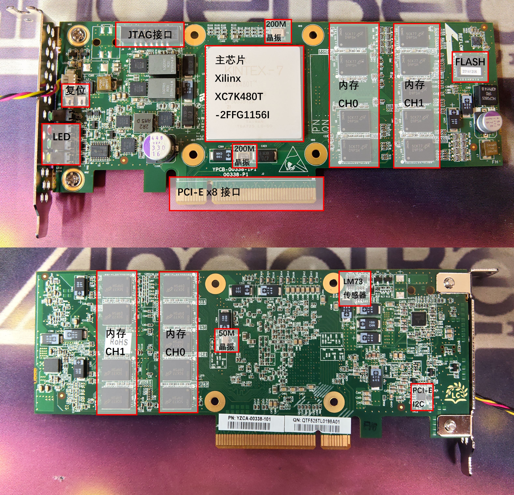
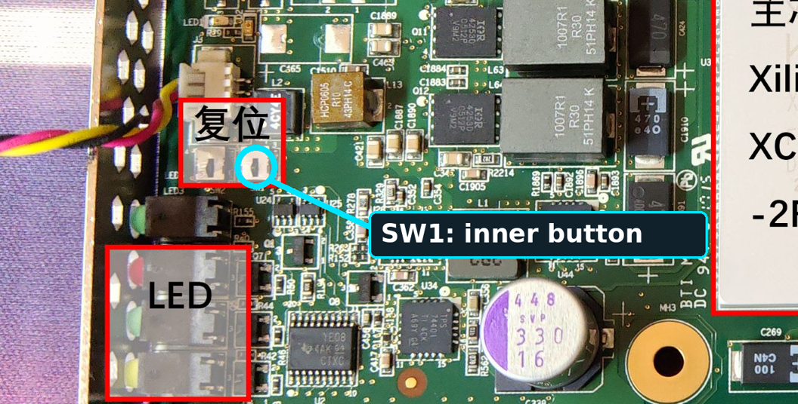
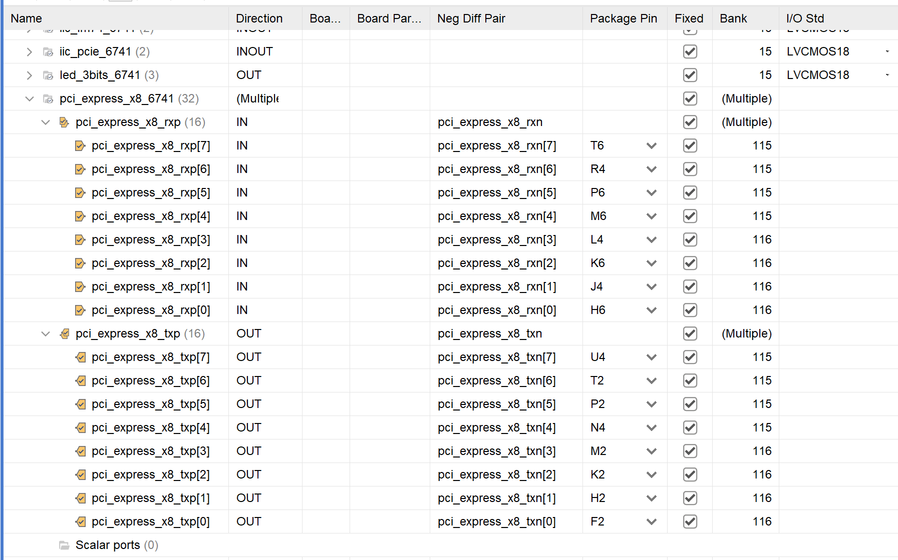
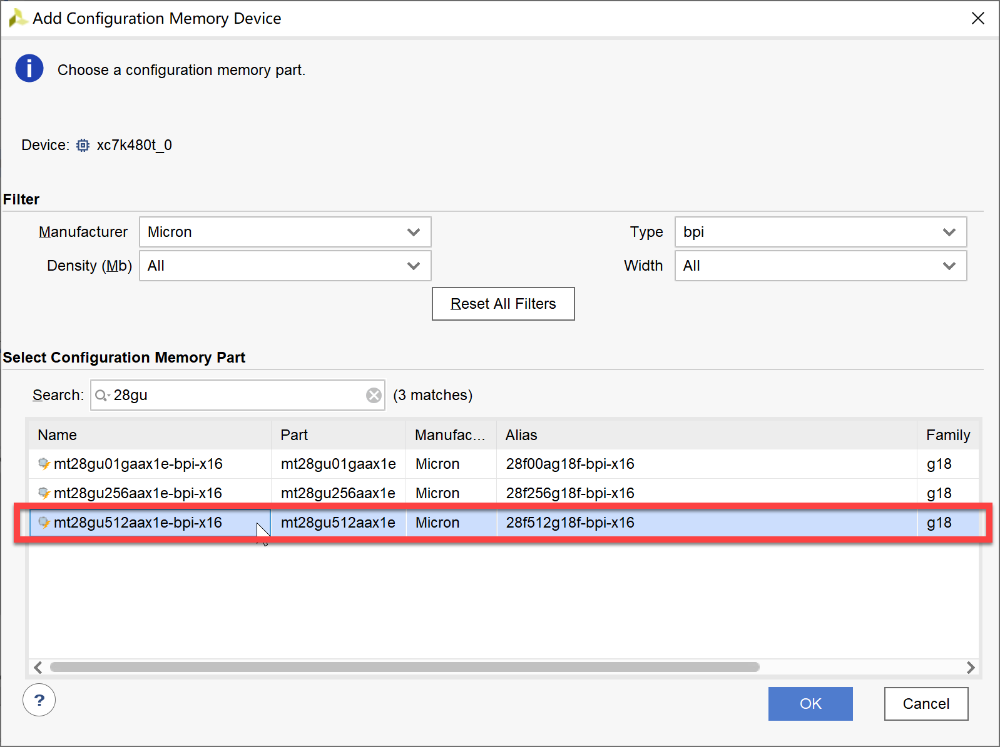

# ypcb_00338_1p1_hack

Reverse engineering resources for the YPCB-00338-1P1 board.

## Contents

 - constraints: Constraint files describing pin functions.
 - documents: Reference documentation.
 - examples: Example projects.
 - ypcb003381p1: Board files.

## Board Layout and Interfaces

The labeled front and back views below locate the XC7K480T FPGA, two DDR3 memory channels (CH0 and CH1), configuration flash, PCIe x8 connector, JTAG header, buttons, LEDs, and LM73 temperature sensor.

The PCIe connector links the FPGA to the host computer. The JTAG header is used with a Xilinx USB programming cable and Vivado Hardware Manager to load a bitstream into the FPGA. This configuration is volatile and is lost when power is removed; the flash stores a configuration for loading at power-on.

## Usage

Copy the ypcb003381p1 folder into Vivado/\<version\>/data/boards/board_files/. If the board_files directory does not exist, create it.

Open Vivado and create a new project. You can then select “YPCB-00338-1P1 Accelerator Card”.

## SW1 Switch Location

SW1 is the **inner button**, farther from the metal PCIe bracket, circled in cyan below. According to the [board author's guide](https://www.tiferking.cn/index.php/2024/12/19/650/), SW1 connects to the FPGA's `INIT_B` pin; SW2 is a user GPIO button.

## PCIe Pin Assignments

The board author's guide notes that Vivado may not automatically apply the PCIe transceiver pin constraints correctly. The screenshot below shows the expected PCIe receive and transmit lane assignments in Vivado's I/O Ports view. Use it alongside the [board constraints](constraints/ypcb003381p1.xdc) when checking your design, adapting port names to match your project.

## Configuration Flash Selection

The board uses a Micron MT28GU512AAA1EGC flash device with a capacity of 512 Mbit (64 MiB) and a 16-bit parallel BPI interface. In Vivado Hardware Manager's **Add Configuration Memory Device** dialog, the matching entry is **mt28gu512aax1e-bpi-x16**, highlighted below. This image identifies the memory device; the complete programming procedure is in the [board author's guide](https://www.tiferking.cn/index.php/2024/12/19/650/).

## More Information

The board photos and Vivado screenshots above are from [TiferKing's board guide](https://www.tiferking.cn/index.php/2024/12/19/650/), with an additional English SW1 callout. Local copies are included in `documents/`.

For more details, see my blog:

https://www.tiferking.cn/index.php/2024/12/19/650/
